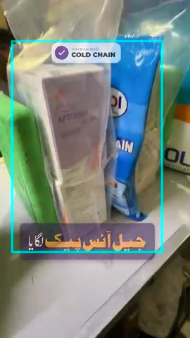

# Storyboard: aftodoll-dispatch

**Output:** 2160x3840, 30 fps, **0:21.3** long, 1 shots, framing: crop

Dispatch of 8 Aftodoll jel FMD vaccines (Dollvet, Turkey, company stock) with full cold chain: out of the fridge, gel ice pack, double bag, handed to Ibrahim bhai for the highway. Owner's AI voice-over.

## Style taken from the reference

Owner 2026-11-26: Urdu heading on frame 1, good Urdu captions (spelling checked, approved list), storage icons, light highway animation, colour correction, editing in the vaccine pack colours (purple #5B2A86 + orange #E8741E + white), eye-catching. Heading chosen by me: 'رکیے! ویکسین خریدنا ہی کافی نہیں!' on a purple plate (matches the first spoken word).

## Shots

### 1. 0:00.0 – 0:21.3 (21.3s)

- **Clip:** `dispatch.mov` 0:00.0–0:21.3
- **What happens:** Fridge -> gel ice -> double bag on counter -> street hand-over to Ibrahim bhai

## Audio

- Original sound from the clips is kept (except muted shots)
- Loudness normalised to -14 LUFS

## Approval

Reply **OK** to render, or list changes by shot number (e.g. "shot 3 shorter, bigger text").
