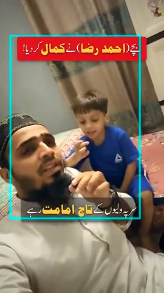

# Storyboard: ahmed-raza

**Output:** 2160x3840, 30 fps, **0:48.4** long, 1 shots, framing: crop

Little Ahmed Raza recites a Ghaus-e-Azam manqabat with his father: 'Shah-e-Jeelan ki chaukhat salamat rahe'. Heading + lyrics, respectful.

## Style taken from the reference

Owner: heading 'بچے (احمد رضا) نے کمال کر دیا', lyrics below, Noori + Aslam combo, 4K, viral for TikTok + Instagram. Naat rule: respectful, no pop/whoosh SFX, soft fades only. Heading white/gold on red plate (TikTok formula), fully visible at 0.0 s.

## Shots

### 1. 0:00.0 – 0:48.4 (48.4s)

- **Clip:** `clip.mov` 0:00.0–0:48.4
- **What happens:** Father and son on the bed reciting the manqabat, selfie angle

## Audio

- Original sound from the clips is kept (except muted shots)
- Loudness normalised to -14 LUFS

## Approval

Reply **OK** to render, or list changes by shot number (e.g. "shot 3 shorter, bigger text").
