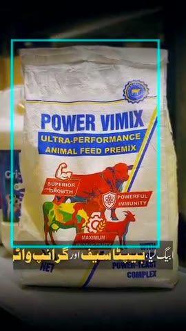

# Storyboard: bacha-hairan

**Output:** 2160x3840, 30 fps, **0:21.5** long, 1 shots, framing: crop

A young boy from a goat farm surprises us: buys Power V-Mix, Hepta Sef and Gripe Water and says their animals stay healthy. Urdu subtitles in Jameel Noori Nastaleeq with Aslam key words.

## Style taken from the reference

Owner: stylish Urdu subtitles (Noori + Aslam combo), big heading 'bache ne hairan kar diya', colours from the video (warm yellow), light motion graphics, SFX, 4K, not over-designed.

## Shots

### 1. 0:00.0 – 0:21.5 (21.5s)

- **Clip:** `clip.mov` 0:00.0–0:21.5
- **What happens:** Boy at the counter, owner reacts, products on the counter

## Audio

- Original sound from the clips is kept (except muted shots)
- Loudness normalised to -14 LUFS

## Approval

Reply **OK** to render, or list changes by shot number (e.g. "shot 3 shorter, bigger text").
