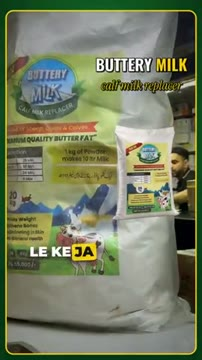

# Storyboard: Buttery Milk

**Output:** 1080x1920, 30 fps, **0:14.5** long, 1 shots, framing: crop

Shop reel: why animals don't gain weight; Buttery Milk (calf milk replacer) going to Sialkot; protein + butter fat for weight, skin shine and a finishing touch.

## Style taken from the reference

brand-cards look in Buttery Milk's own green/yellow; box-pop captions in yellow; map to Sialkot with route + pin; glass boxes on protein / butter fat; stats card; product end card.

## Shots

### 1. 0:00.0 – 0:14.5 (14.5s)

- **Clip:** `clip.mov` 0:00.0–0:14.5
- **What happens:** Hook to camera, then the Buttery Milk bag.
- **On-screen text:** BUTTERY MILK calf milk replacer | 1 kg powder = 10 ltr milk BUTTERY MILK calf milk replacer
- **Captions:** agle ek minute mein / aap ko janwaron ka / wazan kyun nahi / barh raha / pata chal jaye ga / aur aap barhana / bhi seekh jayen ge / to bhai yeh hai / _ bhai / jo ke Butter Milk / le ke ja raha hai / Sialkot ki taraf / aur Butter Milk mein / protein aur / butter fat hota hai / taake janwaron ka / wazan bhi barhe / _ aati hai / chamak ka ek / finishing wala touch hai

## Audio

- Original sound from the clips is kept (except muted shots)
- Loudness normalised to -14 LUFS

## Approval

Reply **OK** to render, or list changes by shot number (e.g. "shot 3 shorter, bigger text").
