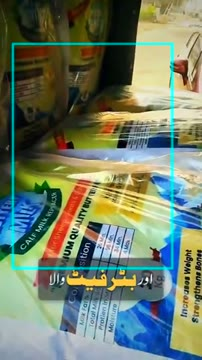

# Storyboard: clip-nov21

**Output:** 2160x3840, 30 fps, **0:10.4** long, 1 shots, framing: crop

Buttery Milk loaded in a pickup, going 150 km from Karachi for 20-25 lakh calves: weight gain, protein and butter fat. 'Result hai na sahab.'

## Style taken from the reference

Noori + Aslam combo, attractive heading, click SFX (owner asked), 150 KM glass widget, Buttery Milk end card, 4K.

## Shots

### 1. 0:00.0 – 0:10.4 (10.4s)

- **Clip:** `clip.mov` 0:00.0–0:10.4
- **What happens:** Pickup loaded with Buttery Milk bags

## Audio

- Original sound from the clips is kept (except muted shots)
- Loudness normalised to -14 LUFS

## Approval

Reply **OK** to render, or list changes by shot number (e.g. "shot 3 shorter, bigger text").
