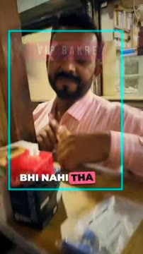

# Storyboard: Danish Goat Farm

**Output:** 1080x1920, 30 fps, **0:17.7** long, 1 shots, framing: crop

Shop reel: why Danish bhai is folding his hands and why his full look was filmed; he raised heavy VIP goats before anyone cared; still buying Korean injections; his Danish Goat Farm.

## Style taken from the reference

bold-clean box-pop captions; palette from the footage (Danish bhai's pink striped shirt + warm wood): rose accent on deep maroon; name strip, typed tag boxes, brand end card, light leak / glitch / blur whip, crisp cinematic look.

## Shots

### 1. 0:00.0 – 0:17.7 (17.7s)

- **Clip:** `clip.mov` 0:00.0–0:17.7
- **What happens:** Danish bhai at the shop, then the injections on the counter.
- **On-screen text:** Danish bhai ki REEL | Danish bhai
- **Captions:** Danish bhai / _ _ karte hue / kyun haath jor / rahe hain / aur Muzammil bhai ne / mujhe in ka / full look lene ka / kyun kaha / to bhai jis waqt / logon ko VIP _ _ / bakron ko hosh / bhi nahi tha na / us waqt hi / bhaari bhaari bakre / paalte the / abhi bhi dekhein / Korea wale injection / le ke ja rahe hain / aur bhai Danish / Goat Farm ke naam se / in ka Gulshan-e Maymar mein / zabardast farm hai

## Audio

- Original sound from the clips is kept (except muted shots)
- Loudness normalised to -14 LUFS

## Approval

Reply **OK** to render, or list changes by shot number (e.g. "shot 3 shorter, bigger text").
