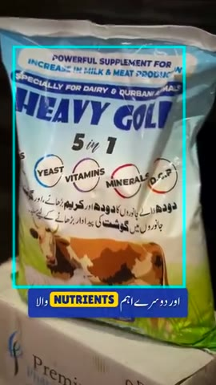

# Storyboard: disco-bakery

**Output:** 2160x3840, 30 fps, **0:10.1** long, 1 shots, framing: crop

Heavy Gold bag going to Disco Bakery, Gulshan-e-Iqbal: vitamins, minerals, nutrients; benefit for qurbani animals and milk; a bag that sells on demand.

## Style taken from the reference

Owner: colours more attractive, no clutter. Heavy GOLD brand palette: royal-blue plates + gold accents (Aslam gold key words, English words on gold Lilita pills), heading = white Aslam on royal blue + navy Noori on a gold plate, punchier grade, bigger end card. Click SFX per line.

## Shots

### 1. 0:00.0 – 0:10.1 (10.1s)

- **Clip:** `clip.mov` 0:00.0–0:10.1
- **What happens:** Heavy Gold 20 kg bag on a carton, camera moves in

## Audio

- Original sound from the clips is kept (except muted shots)
- Loudness normalised to -14 LUFS

## Approval

Reply **OK** to render, or list changes by shot number (e.g. "shot 3 shorter, bigger text").
