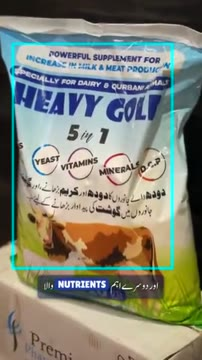

# Storyboard: disco-bakery

**Output:** 2160x3840, 30 fps, **0:10.1** long, 1 shots, framing: crop

Heavy Gold bag going to Disco Bakery, Gulshan-e-Iqbal: vitamins, minerals, nutrients; benefit for qurbani animals and milk; a bag that sells on demand.

## Style taken from the reference

Same as clip-nov21: Noori subtitles + Aslam sky-blue key words, English words on royal-blue Lilita pills (Heavy Gold bag palette), heading on royal-blue plates, mini trip bar, Heavy Gold end card on a crystal disc, click SFX, 4K, brighter + more saturated. Owner: don't clutter text -> no subtitles under the heading, no trip bar, smaller subtitles.

## Shots

### 1. 0:00.0 – 0:10.1 (10.1s)

- **Clip:** `clip.mov` 0:00.0–0:10.1
- **What happens:** Heavy Gold 20 kg bag on a carton, camera moves in

## Audio

- Original sound from the clips is kept (except muted shots)
- Loudness normalised to -14 LUFS

## Approval

Reply **OK** to render, or list changes by shot number (e.g. "shot 3 shorter, bigger text").
