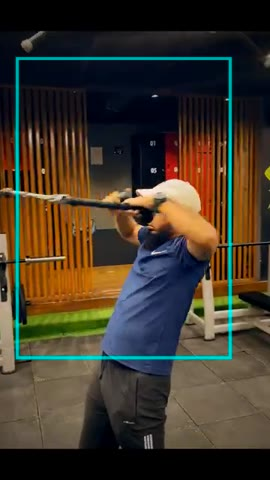

# Storyboard: gym-comeback

**Output:** 2160x3840, 30 fps, **0:13.8** long, 1 shots, framing: crop

Owais Turabi back in the gym after 1.5 months (One Generation Gym, SMCHS). Cinematic 'Day One' story built on the gym wall sign 'One day or day one - it's your decision'.

## Style taken from the reference

Personal, not business. Film-title typography (Anton + Poppins + Instrument Serif italic), letterbox, moody teal/orange grade, no gimmicks so it doesn't look AI-made.

## Shots

### 1. 0:00.0 – 0:13.8 (13.8s)

- **Clip:** `clip.mov` 0:00.0–0:13.8
- **What happens:** Overhead cable triceps extensions, camera orbits slowly
- **On-screen text:** after 1.5 months DAY ONE. | OWAIS TURABI One Generation Gym  ·  SMCHS | one day or DAY ONE. | it's your decision.

## Audio

- Original sound from the clips is kept (except muted shots)
- Loudness normalised to -14 LUFS

## Approval

Reply **OK** to render, or list changes by shot number (e.g. "shot 3 shorter, bigger text").
