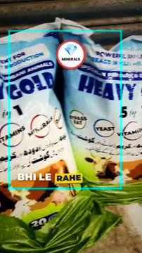
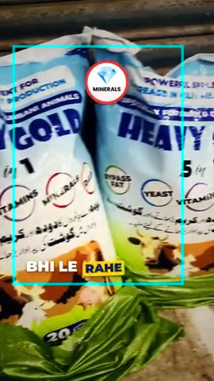

# Storyboard: Anas bhai – Khanpur

**Output:** 1080x1920, 30 fps, **0:18.8** long, 1 shots, framing: crop

Dispatch reel: two bags of Heavy Gold going from Karachi to Anas bhai in Khanpur; Khanpur folks are big cattle-farming enthusiasts; also taking minerals powder; top-notch product, result hai.

## Style taken from the reference

Heavy Gold palette (gold + royal blue); map Karachi to Khanpur; big headings 'Anas bhai ka maal' / 'Anas bhai · Khanpur'; elegant cutout mockup on a grey glass disc; 'BADE SHAUQEEN' sticker; dispatch look; crisp cinematic grade.

## Shots

### 1. 0:00.0 – 0:18.8 (18.8s)

- **Clip:** `clip.mov` 0:00.0–0:18.8
- **What happens:** Heavy Gold bags packed for dispatch.
- **Captions:** Khanpur ki taraf / Anas bhai ko / ja rahe hain / do bag / Heavy Gold ke / VIP _ _ / cattle farming ke / hawale se / log bade shauqeen hain bhai / minerals ka powder / bhi le rahe hain / to woh powder / jo koi top-notch _ / chalta hai naam se / ke agar variety _ / of customers ke / hawale se dekha jaye / to bhai yeh / top powder hai / result hai na

## Audio

- Original sound from the clips is kept (except muted shots)
- Loudness normalised to -14 LUFS

## Approval

Reply **OK** to render, or list changes by shot number (e.g. "shot 3 shorter, bigger text").
