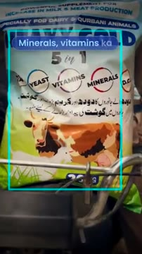
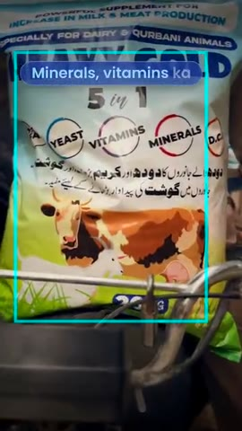

# Storyboard: heavy-gold-liaquatabad

**Output:** 2160x3840, 30 fps, **0:12.9** long, 1 shots, framing: crop

Heavy Gold 2 bags to Ali bhai, Liaquatabad Karachi. Repeat purchase. Simple cinematic, owner's subtitles.

## Style taken from the reference

Owner: simple cinematic, light bottom masking, stylish Poppins captions at the top, colours from the Heavy Gold bag.

## Shots

### 1. 0:00.0 – 0:12.9 (12.9s)

- **Clip:** `clip2.mov` 0:00.0–0:12.9
- **What happens:** Ali bhai with Heavy Gold bags on a bike
- **Captions:** Liaquatabad, Karachi / ka mashhoor ilaqa. / Wahan par Ali bhai ko / do bag ja rahe hain, / bhai, Heavy Gold ke. / Minerals, vitamins ka / zabardast powder / hai, bhai. / Repeat purchase pe / ja raha hai, bhai, ye. / Acchi product ki / asal pehchan hi / yahi hoti hai.

## Audio

- Original sound from the clips is kept (except muted shots)
- Loudness normalised to -14 LUFS

## Approval

Reply **OK** to render, or list changes by shot number (e.g. "shot 3 shorter, bigger text").
