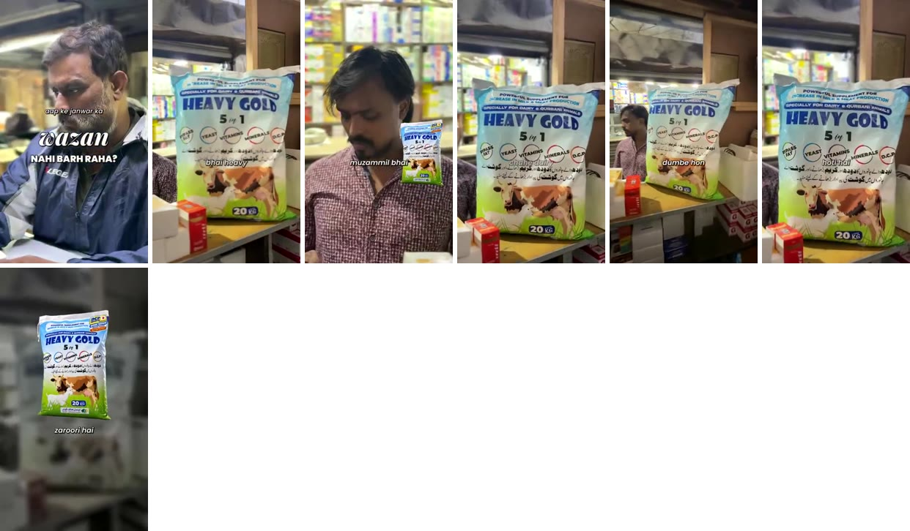
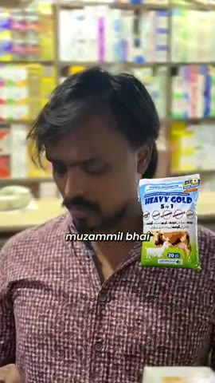
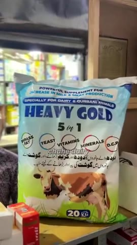

# Storyboard: Heavy Gold reel

**Output:** 1080x1920, 30 fps, **0:20.0** long, 7 shots, framing: crop

Shop reel for Heavy Gold 5-in-1 feed supplement: hook on animals not gaining weight, product reveal, why it is needed (vitamins, minerals, calcium, Japanese DCP), strong ending.

## Style taken from the reference

Default style italic-kinetic: lowercase italic Roman Urdu captions mid-frame, stacked mixed-font emphasis titles on key lines, fast feel with gentle push-ins and punch-ins.

## Shots

### 1. 0:00.0 – 0:02.2 (2.2s)

- **Clip:** `IMG_5930.mov` 0:00.0–0:02.2
- **What happens:** Hook: customer at the counter. 'Aap ke janwar ka bhi wazan nahi barh raha na?'
- **On-screen text:** aap ke janwar ka wazan nahi barh raha?
- **Then:** hard cut

### 2. 0:02.2 – 0:04.3 (2.1s)

- **Clip:** `IMG_5930.mov` 0:02.2–0:04.3
- **What happens:** The Heavy Gold bag on the counter. Product cutout pops in when 'Heavy Gold' is said.
- **Captions:** to bhai / yeh Kaleem / bhai Heavy / Gold le / kar ja
- **Then:** hard cut

### 3. 0:04.3 – 0:06.5 (2.2s)

- **Clip:** `IMG_5930.mov` 0:04.3–0:06.5
- **What happens:** Shop staff.
- **Captions:** rahe hain / Muzammil bhai / ne [?] / kar diya
- **Then:** hard cut

### 4. 0:06.5 – 0:09.3 (2.8s)

- **Clip:** `IMG_5930.mov` 0:06.5–0:09.3
- **What happens:** Bag close-up: for dairy and qurbani animals.
- **Captions:** is ki / zaroorat hoti / hai bhai / chahe dairy / [?] chahe
- **Then:** hard cut

### 5. 0:09.3 – 0:12.1 (2.8s)

- **Clip:** `IMG_5930.mov` 0:09.3–0:12.1
- **What happens:** Bag: goats, dumbas. Vitamins + minerals title.
- **On-screen text:** vitamins aur minerals
- **Captions:** qurbani ke / hon chahe / bakre hon / dumbe hon / kyunke bhai
- **Then:** hard cut

### 6. 0:12.1 – 0:17.0 (4.9s)

- **Clip:** `IMG_5930.mov` 0:12.1–0:17.0
- **What happens:** Bag: calcium, DCP from Japan, bone based. Punch-in on 'DCP Japan wala'.
- **On-screen text:** vitamins aur minerals | DCP japan wala bone based
- **Captions:** parti hai / calcium ki / bhi need / hoti hai / to is mein
- **Then:** hard cut

### 7. 0:17.0 – 0:20.0 (3.0s)

- **Clip:** `IMG_5930.mov` 0:17.0–0:20.0
- **What happens:** Ending: 'Bohat zaroori hai bhai'. Background blurs and darkens, product cutout pops up big in the centre.
- **On-screen text:** DCP japan wala bone based
- **Captions:** hai, bohat / zaroori hai / bhai yeh / sab cheez / hai

## Audio

- Original sound from the clips is kept (except muted shots)
- Loudness normalised to -14 LUFS

## Approval

Reply **OK** to render, or list changes by shot number (e.g. "shot 3 shorter, bigger text").
