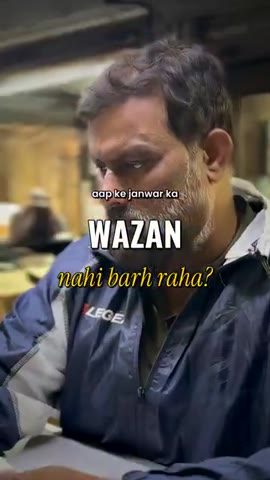
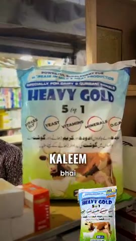
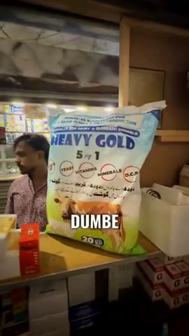
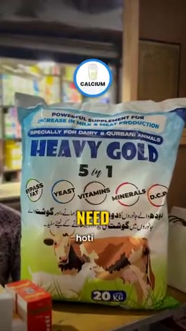
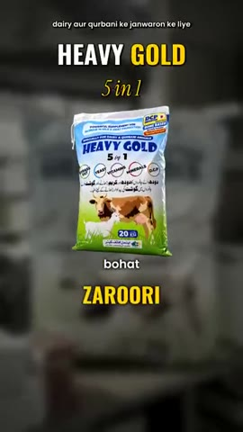

# Storyboard: Heavy Gold reel

**Output:** 1080x1920, 30 fps, **0:20.0** long, 7 shots, framing: crop

Shop reel for Heavy Gold 5-in-1 feed supplement: hook on animals not gaining weight, product reveal, why it is needed (vitamins, minerals, calcium, Japanese DCP), strong ending.

## Style taken from the reference

Default style bold-clean: clean video, bold Poppins captions with gold active word and Anton gold brand name, product cutout rising from the bottom on 'Heavy Gold', icon badges for vitamins/minerals/calcium/DCP as they are said, product card ending, SFX on key moments.

## Shots

### 1. 0:00.0 – 0:02.2 (2.2s)

- **Clip:** `IMG_5930.mov` 0:00.0–0:02.2
- **What happens:** Hook: customer at the counter. 'Aap ke janwar ka bhi wazan nahi barh raha na?'
- **On-screen text:** aap ke janwar ka WAZAN nahi barh raha?
- **Then:** hard cut

### 2. 0:02.2 – 0:04.3 (2.1s)

- **Clip:** `IMG_5930.mov` 0:02.2–0:04.3
- **What happens:** The bag on the counter. On 'Heavy Gold' the product cutout rises from the bottom on the right.
- **On-screen text:** HEAVY GOLD 5 in 1
- **Captions:** to bhai yeh / Kaleem bhai / _ _ / le kar ja
- **Then:** hard cut

### 3. 0:04.3 – 0:06.5 (2.2s)

- **Clip:** `IMG_5930.mov` 0:04.3–0:06.5
- **What happens:** Shop staff.
- **Captions:** rahe hain / Muzammil bhai ne _ / kar diya
- **Then:** hard cut

### 4. 0:06.5 – 0:09.3 (2.8s)

- **Clip:** `IMG_5930.mov` 0:06.5–0:09.3
- **What happens:** Bag close-up: for dairy and qurbani animals.
- **Captions:** is ki zaroorat / hoti hai bhai / chahe dairy _ / chahe qurbani
- **Then:** hard cut

### 5. 0:09.3 – 0:12.1 (2.8s)

- **Clip:** `IMG_5930.mov` 0:09.3–0:12.1
- **What happens:** Bag: goats, dumbas. VITAMINS and MINERALS badges pop up as they are said.
- **Captions:** ke hon / chahe bakre hon / dumbe hon kyunke / bhai vitamins aur
- **Then:** hard cut

### 6. 0:12.1 – 0:17.0 (4.9s)

- **Clip:** `IMG_5930.mov` 0:12.1–0:17.0
- **What happens:** Bag: CALCIUM badge, then D.C.P (Japan, bone based) badge with a 'ching'. Punch-in on 'DCP Japan wala'.
- **Captions:** minerals ki bhi / zaroorat parti hai / calcium ki bhi / need hoti hai / to is mein / DCP _ Japan / wala bone based / _
- **Then:** hard cut

### 7. 0:17.0 – 0:20.0 (3.0s)

- **Clip:** `IMG_5930.mov` 0:17.0–0:20.0
- **What happens:** Ending: 'Bohat zaroori hai bhai'. Background blurs and darkens, the bag rises up big in the centre.
- **On-screen text:** dairy aur qurbani ke janwaron ke liye HEAVY GOLD 5 in 1
- **Captions:** wala dala hai / bohat zaroori hai / bhai yeh sab / cheez hai

## Audio

- Original sound from the clips is kept (except muted shots)
- Loudness normalised to -14 LUFS

## Approval

Reply **OK** to render, or list changes by shot number (e.g. "shot 3 shorter, bigger text").
