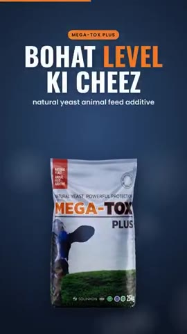

# Storyboard: Mega-Tox Plus

**Output:** 1080x1920, 30 fps, **0:18.2** long, 1 shots, framing: crop

Shop reel: Mega-Tox Plus (natural yeast toxin binder) – what's in it, price is fair but quality is top level, protects farm animals from disease (mastitis, zehar-baad).

## Style taken from the reference

Owner's default bold-clean with box-pop captions in the product's orange; brand-cards look (framed footage, navy/orange product card); product cutout rises on the product name with an Oswald title; badges for each ingredient as spoken.

## Shots

### 1. 0:00.0 – 0:18.2 (18.2s)

- **Clip:** `clip.mov` 0:00.0–0:18.2
- **What happens:** Shopkeeper with the Mega-Tox bag on a motorbike explains the product.
- **On-screen text:** MEGA- TOX plus | natural yeast · powerful protection MEGA- TOX plus
- **Captions:** Turkey ka zabardast / toxin binder / kuch vitamins bhi hai / yeast wala bhi hai / aur ek tarah ka / is mein tonic bhi hai / price Tag is ka / darmiyana hai / lekin cheez bohat / level ki hai bhai / aur farm walon ki / ashad zaroorat hai / taake bimariyon se / bhi bache aur / janwar phale phoole / warna Saari yaani ke / mastitis aur / zehar-baad aajata hai / na Kabara hojata hai

## Audio

- Original sound from the clips is kept (except muted shots)
- Loudness normalised to -14 LUFS

## Approval

Reply **OK** to render, or list changes by shot number (e.g. "shot 3 shorter, bigger text").
