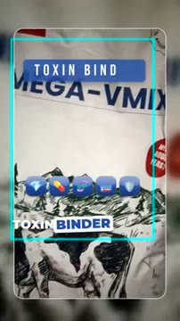
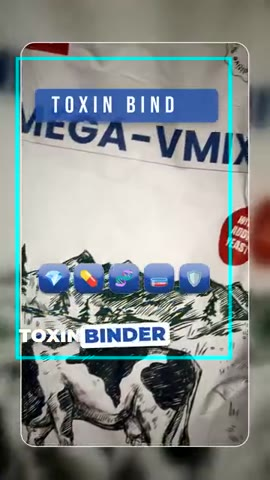

# Storyboard: mega-vmix-features

**Output:** 2160x3840, 30 fps, **0:14.9** long, 1 shots, framing: crop

Mega-VMix: 2 bags for Zeeshan bhai (BEFS farm, Rawalpindi). Ingredients typed in with iPhone keyboard sound.

## Style taken from the reference

IG reel: before/after motion graphics, full-screen brand card with big number, glossy icon tiles popping in a row, digit counters. Plus locked house look v2.

## Shots

### 1. 0:00.0 – 0:14.9 (14.9s)

- **Clip:** `clip.mov` 0:00.0–0:14.9
- **What happens:** Mega-VMix bags -> Zeeshan bhai
- **Captions:** qurbani wale janwaron / ke liye zabardast / quality ka / Turkey ka / minerals / vitamins / biotin / yeast aur / toxin binder wale / do bag ja rahe hain / VEFS farm ke / rooh-e rawaan / hamare Zeeshan bhai / Rawal Pindi wale / un ko ja rahe hain bhai / quality hai na bhai

## Audio

- Original sound from the clips is kept (except muted shots)
- Loudness normalised to -14 LUFS

## Approval

Reply **OK** to render, or list changes by shot number (e.g. "shot 3 shorter, bigger text").
