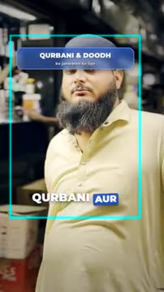

# Storyboard: Mega-VMix

**Output:** 1080x1920, 30 fps, **0:12.8** long, 1 shots, framing: crop

Shop reel: Mega-VMix, a strong vitamin premix with yeast; being sent to Rawalpindi; essential for qurbani and dairy animals.

## Style taken from the reference

Butter-Milk-style box-pop captions in the bag's blue (white text); product-coloured blue glass boxes for key points; map Karachi (Denso Hall) to Rawalpindi; minimal graphics so the footage stays visible; product end card.

## Shots

### 1. 0:00.0 – 0:12.8 (12.8s)

- **Clip:** `clip.mov` 0:00.0–0:12.8
- **What happens:** Bag, then the shop boy, then bags on the bike.
- **On-screen text:** PREMIX · 25 KG MEGA- VMIX vitamins · yeast
- **Captions:** bhai vitamins _ / ka tagra powder hai / yeast bhi / is mein _ bhi hai / Rawalpindi _ / ki taraf yeh / bhijwa-rahe hain / qurbani aur doodh / ke janwaron mein / ashad zaroori hai yeh

## Audio

- Original sound from the clips is kept (except muted shots)
- Loudness normalised to -14 LUFS

## Approval

Reply **OK** to render, or list changes by shot number (e.g. "shot 3 shorter, bigger text").
