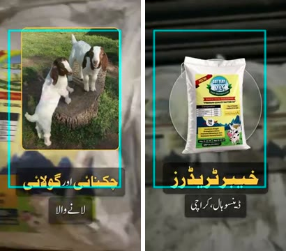
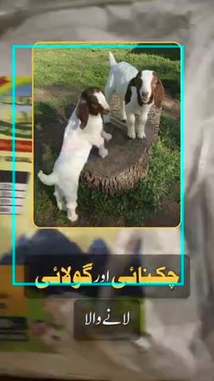
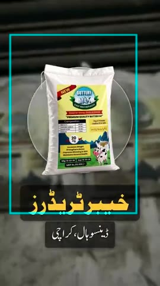

# Storyboard: perfume-chowk

**Output:** 2160x3840, 30 fps, **0:12.3** long, 2 shots, framing: crop

Buttery Milk going to Perfume Chowk: weight gain, fat and roundness; only for expensive calves. Noori + Aslam Urdu subtitles, qurbani-animal photo cards, Buttery Milk end card.

## Style taken from the reference

Same Noori + Aslam combo as bacha-hairan (owner: it did well). Big heading, photos when animals are mentioned, 4K.

## Shots

### 1. 0:00.0 – 0:09.6 (9.6s)

- **Clip:** `clip2.mov` 0:00.0–0:09.6
- **What happens:** Buttery Milk bags (owner's voice-over)
- **Then:** hard cut

### 2. 0:09.6 – 0:12.3 (2.7s)

- **Clip:** `clip2.mov` 0:05.2–0:07.9 (muted)
- **What happens:** Bags close-up behind the end card

## Audio

- Original sound from the clips is kept (except muted shots)
- Loudness normalised to -14 LUFS

## Approval

Reply **OK** to render, or list changes by shot number (e.g. "shot 3 shorter, bigger text").
