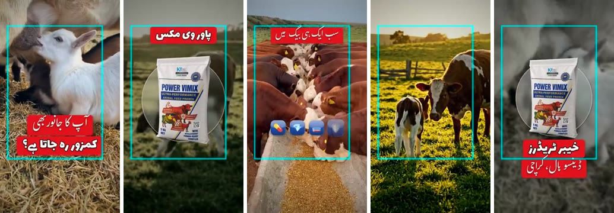
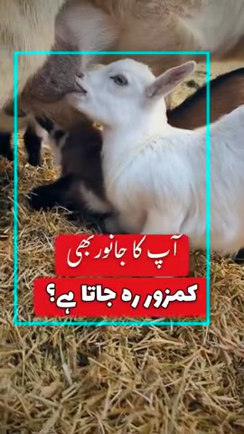
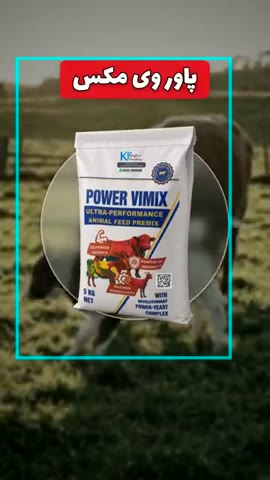
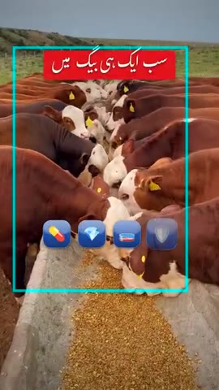
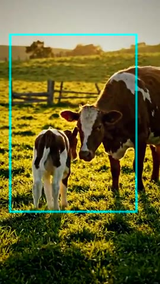
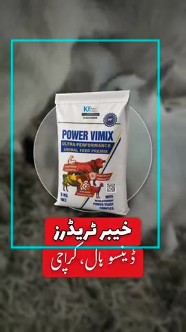

# Storyboard: power-vimix

**Output:** 2160x3840, 30 fps, **0:15.0** long, 5 shots, framing: crop

Power V-Mix 15 s TikTok/FB ad: Urdu red-plate hook on frame 1 (goat kid), product reveal, ingredients as icon tiles over cattle eating, all-animals line, Khyber Traders end. Urdu voice-over (TTS, ur-PK male).

## Style taken from the reference

Owner's TikTok formula (styles/urdu-hook): animals in frame, white Urdu on red plate at 0.0 s, 15 s, loud attractive voice-over.

## Shots

### 1. 0:00.0 – 0:03.0 (3.0s)

- **Clip:** `clip3.mp4` 0:00.6–0:03.6 (muted)
- **What happens:** Goat kid nursing (hook)
- **Then:** hard cut

### 2. 0:03.0 – 0:05.6 (2.6s)

- **Clip:** `clip1.mp4` 0:00.3–0:02.9 (muted)
- **What happens:** Cow and calf in golden light (product reveal)
- **Then:** hard cut

### 3. 0:05.6 – 0:09.8 (4.2s)

- **Clip:** `clip2.mp4` 0:00.5–0:04.7 (muted)
- **What happens:** Herd eating at the feed trough (ingredients)
- **Then:** hard cut

### 4. 0:09.8 – 0:12.4 (2.6s)

- **Clip:** `clip1.mp4` 0:03.0–0:05.6 (muted)
- **What happens:** Cow and calf (all animals)
- **Then:** hard cut

### 5. 0:12.4 – 0:15.0 (2.6s)

- **Clip:** `clip3.mp4` 0:06.0–0:08.6 (muted)
- **What happens:** Goat kid (end card behind)

## Audio

- Loudness normalised to -14 LUFS

## Approval

Reply **OK** to render, or list changes by shot number (e.g. "shot 3 shorter, bigger text").
