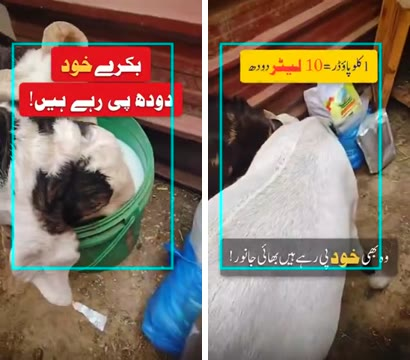
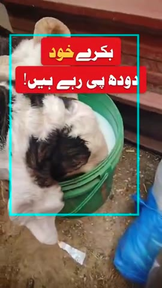
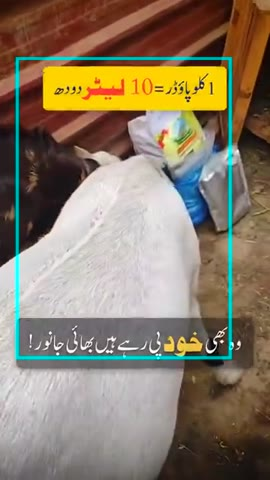

# Storyboard: rooftop-milk

**Output:** 2160x3840, 30 fps, **0:16.4** long, 2 shots, framing: crop

Naveed bhai's rooftop goats drink Buttery Milk straight from a bucket. Cold open on the drinking + big white-on-red Urdu hook, then the owner's 15 s walk-through.

## Style taken from the reference

Owner: 'use your intelligence, make it go viral'. TikTok formula: animal + Urdu hook fully visible at 0.0 s (white on red), cold open with the best shot (goats drinking), Noori+Aslam captions one line at a time, click SFX, name chip + 1kg=10L chip in the top safe area, Buttery Milk card when named, bright grade, 4K. Owner 2026-11-25: Naveed bhai's sticker only when he's introduced (fun pop, ~2.3 s); bag mockup moved from the drinking shot to the end reveal.

## Shots

### 1. 0:00.0 – 0:01.4 (1.4s)

- **Clip:** `clip.mov` 0:10.6–0:12.0
- **What happens:** COLD OPEN: goats drinking Buttery Milk from the bucket
- **Then:** hard cut

### 2. 0:01.4 – 0:16.4 (15.0s)

- **Clip:** `clip.mov` 0:00.0–0:15.0
- **What happens:** Owner's walk-through: rooftop setup, goats, bag, goats drinking

## Audio

- Original sound from the clips is kept (except muted shots)
- Loudness normalised to -14 LUFS

## Approval

Reply **OK** to render, or list changes by shot number (e.g. "shot 3 shorter, bigger text").
