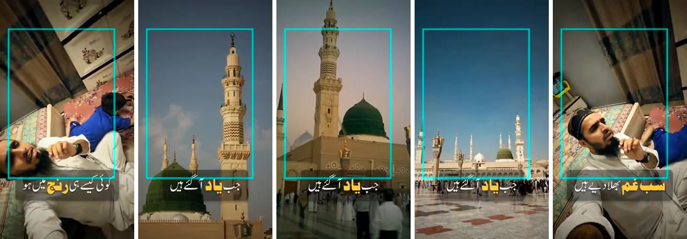
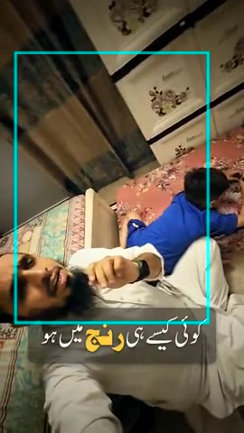
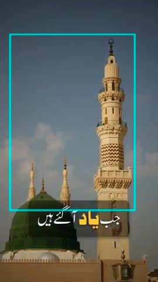
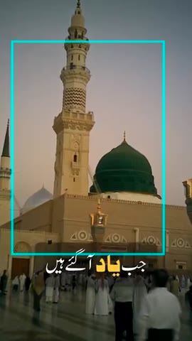
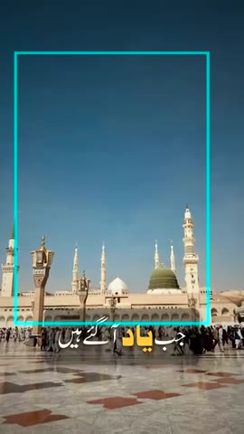
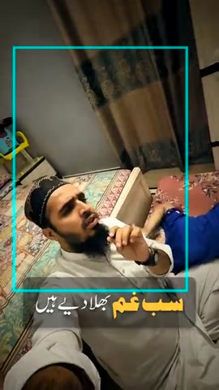

# Storyboard: sab-gham

**Output:** 2160x3840, 30 fps, **0:27.1** long, 5 shots, framing: crop

Naat (Ala Hazrat): 'Un ke nisar koi kaise hi ranj mein ho / jab yaad aa gaye hain sab gham bhula diye hain'. Owner recites; Madina (Green Dome) on 'jab yaad aa gaye hain'.

## Style taken from the reference

Noori + Aslam combo (owner's favourite), respectful: no pop/whoosh SFX, warm glow transition, polished voice with soft hall, 4K. Madina photos CC0 (Wikimedia Commons).

## Shots

### 1. 0:00.0 – 0:14.3 (14.3s)

- **Clip:** `clip.mov` 0:00.0–0:14.3 (muted)
- **What happens:** Owner reciting (selfie)
- **Then:** hard cut

### 2. 0:14.3 – 0:16.3 (2.0s)

- **Clip:** `madina-1.mp4` 0:00.0–0:02.0 (muted)
- **What happens:** Green Dome close-up
- **Then:** hard cut

### 3. 0:16.3 – 0:18.3 (2.0s)

- **Clip:** `madina-2.mp4` 0:00.0–0:02.0 (muted)
- **What happens:** Green Dome and minaret
- **Then:** hard cut

### 4. 0:18.3 – 0:20.3 (2.0s)

- **Clip:** `madina-3.mp4` 0:00.0–0:02.0 (muted)
- **What happens:** Masjid an-Nabawi courtyard
- **Then:** hard cut

### 5. 0:20.3 – 0:27.1 (6.8s)

- **Clip:** `clip.mov` 0:20.3–0:27.1 (muted)
- **What happens:** Owner reciting, closing line

## Audio

- Loudness normalised to -14 LUFS

## Approval

Reply **OK** to render, or list changes by shot number (e.g. "shot 3 shorter, bigger text").
