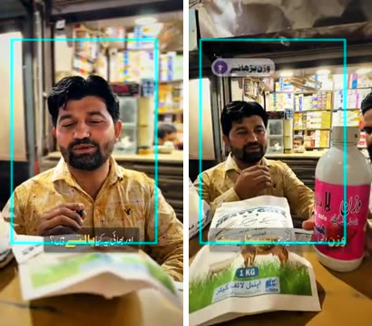
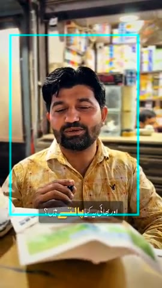
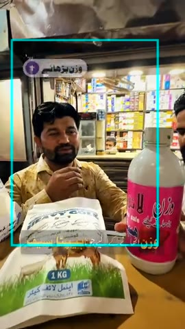

# Storyboard: tariq-feedback

**Output:** 2160x3840, 30 fps, **0:26.4** long, 2 shots, framing: crop

Customer Tariq Shirazi sahab (with Naveed bhai) gives feedback: Heavy Gold 1 kg clears the khurli, Gripe Water at nahar munh with water, Hepta Sef for weight. Hook: 'صرف چارہ کافی نہیں'.

## Style taken from the reference

Owner: Aslam white heading at start over blurred video, then video starts; Noori+Aslam captions mostly Urdu, a little Montserrat/Poppins (product cards); colour correction, 4K; Tariq voice louder + denoised; show HG 1 kg pouch / Gripe Water / Hepta Sef when named; water-flow SFX on 'paani ke saath'; click SFX; small animations that don't take the screen (khurli icon, water chip, wazan chip, numbered product cards 01/02/03).

## Shots

### 1. 0:00.0 – 0:14.0 (14.0s)

- **Clip:** `part-a-voice.mov` 0:00.0–0:14.0
- **What happens:** Owner intro + Tariq sahab: Heavy Gold
- **Then:** hard cut

### 2. 0:14.0 – 0:26.4 (12.4s)

- **Clip:** `part-b-voice.mov` 0:00.0–0:12.4
- **What happens:** Tariq sahab: Gripe Water and Hepta Sef

## Audio

- Original sound from the clips is kept (except muted shots)
- Loudness normalised to -14 LUFS

## Approval

Reply **OK** to render, or list changes by shot number (e.g. "shot 3 shorter, bigger text").
