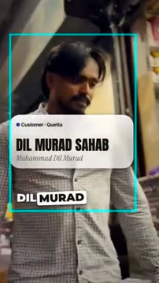

# Storyboard: Dil Murad sahab - Quetta

**Output:** 1080x1920, 30 fps, **0:12.5** long, 1 shots, framing: crop

Quetta customer Dil Murad sahab ka maal: Heavy Gold, Mega-VMix, Hepta Sef, vaccines. Trust story.

## Style taken from the reference

Locked house look; brighter colourful grade; light glass widgets (white glass, black text).

## Shots

### 1. 0:00.0 – 0:12.5 (12.5s)

- **Clip:** `clip.mov` 0:00.0–0:12.5
- **What happens:** Bags -> Mega-VMix -> customer -> Hepta Sef + vaccines
- **Captions:** chaar din pehle / paise de gaye? _ / aaj maal lene aaye / ji sir, / logon ka trust hai / Quetta se hain / Dil Murad sahab / Muhammad Dil Murad sahab / woh Heavy Gold / Hepta-Sef / Vaccines / bhai log bada / trust karte hain

## Audio

- Original sound from the clips is kept (except muted shots)
- Loudness normalised to -14 LUFS

## Approval

Reply **OK** to render, or list changes by shot number (e.g. "shot 3 shorter, bigger text").
