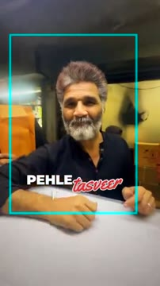

# Storyboard: uncle-megavmix

**Output:** 2160x3840, 30 fps, **0:10.2** long, 1 shots, framing: crop

Sample: an uncle comes for a Mega-VMix bag; the customer who sent him had sent his photo first, so we recognised him the moment he walked in.

## Style taken from the reference

Owner's viral plain-captions look (white caps + red script word typing in, keys SFX), 4K source, owais-voice story.

## Shots

### 1. 0:00.0 – 0:10.2 (10.2s)

- **Clip:** `clip.mov` 0:00.0–0:10.2
- **What happens:** Uncle at the counter, selfie greeting, Mega-VMix bag, uncle waves and hugs the bag
- **Captions:** Yeh Uncle / aaye hain / Mega-VMix / ka bag lene / jinhon ne bheja / pehle tasveer bheji / phir Uncle ko / aate hi hum / pehchan gaye / shukriya Uncle

## Audio

- Original sound from the clips is kept (except muted shots)
- Loudness normalised to -14 LUFS

## Approval

Reply **OK** to render, or list changes by shot number (e.g. "shot 3 shorter, bigger text").
