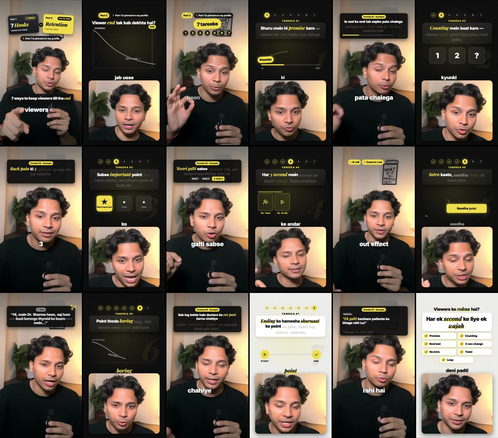

# Style: explainer-ui (tips / list / "tareeka" videos)

Learned from an Instagram reel (Hinglish talking-head explainer "7 ways to keep viewers till
the end", @riteshoncontent) shared by the owner on 2026-11-16.

- **Split screen:** speaker in a rounded card in the lower half; upper half is a dark
  (#0B0B0B → #222 radial) UI panel. → `"frame": {"layout": "split", "split": 0.5, "margin": 0.08,
  "border": 0}` with a dark `brand`.
- **UI panels:** step tracker 1..N (done ✓ outlined in yellow, current filled yellow), small
  letter-spaced yellow label ("TAREEKA #3"), optional yellow pill ("Tareeka #2 · Example"), and a
  sentence whose words light up from grey to white as they are spoken; key words in yellow
  Playfair italic. → card `"type": "panel"` (`"area": "top-half"` or a floating card).
- Also: retention-curve / icon-tile mini graphics, "Twist" stickers; ending in a light theme
  (white panels) with a checklist and a follow card. → `"light": true`.
- **Captions:** one word at a time between the panel and the speaker, white Poppins SemiBold;
  key words in yellow serif italic. → template `explainer`, `words_per_line` 1–2, `y` ≈ 0.47.
- Colours: black, panel #161616, yellow #F7D33A, white. Good for farm-tip series
  ("Tareeka #1..5", "Galti #1..3") from guides/shop-story-reels.md.
