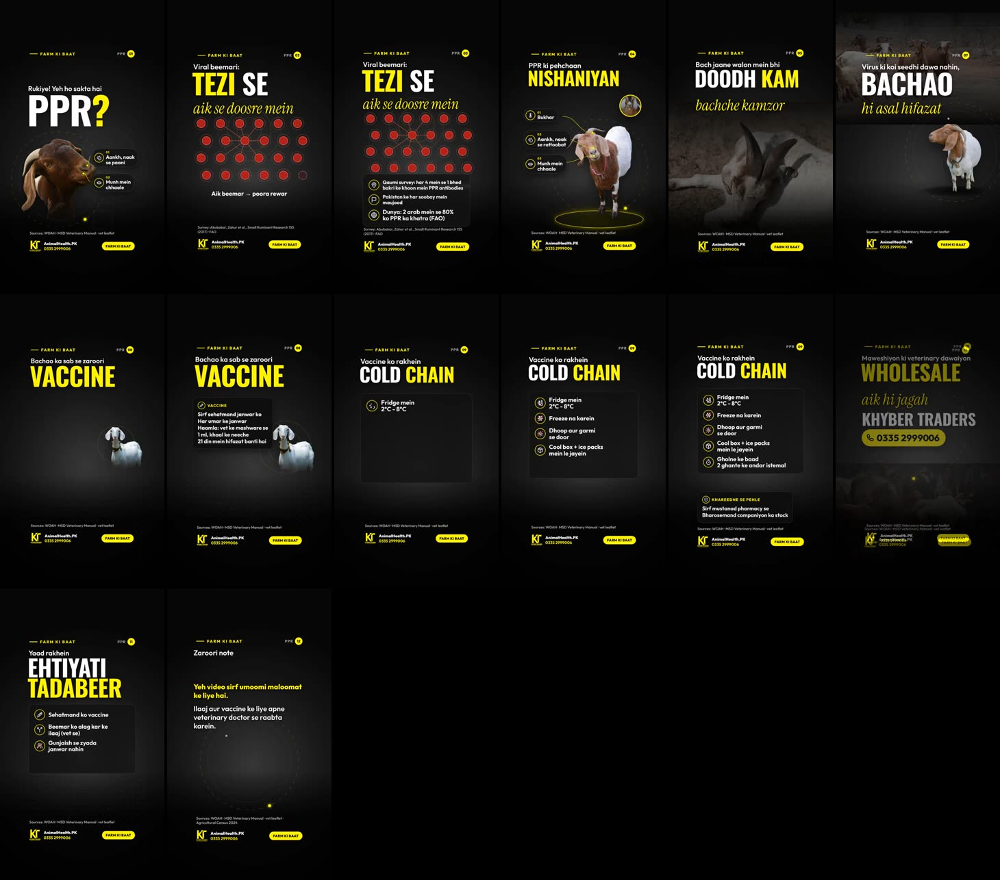

# Style: farm-ki-baat (typography + colour system, absorbed into the default)

Learned from a Facebook explainer reel (AnimalHealth.PK "Farm ki Baat", PPR in goats)
shared by the owner on 2026-11-15: "absorb its font and colour scheme".

## Typography (the headline system)
Three layers, left-aligned or centred, always in this order:
1. **Label** – small white sans, sentence case: "Viral beemari:", "Rukiye! Yeh ho sakta hai"
   → Poppins SemiBold, ~3.5% of height.
2. **Headline** – huge condensed caps, two-tone (one word white, one word yellow):
   "TEZI SE", "COLD CHAIN", "DOODH KAM", "VACCINE" → **Oswald Bold**, ~8–10%.
3. **Accent line** – yellow serif italic, lowercase: "aik se doosre mein", "bachche kamzor",
   "hi asal hifazat" → **Instrument Serif Italic**, ~5–6%.

Small extras: header strip "— FARM KI BAAT … PPR 03" (yellow, letter-spaced caps, numbered
yellow dot), footer with logo + phone and a yellow pill button.

## Colour
- Near-black background (#0B0B0B) with a soft spotlight, white text, ONE accent colour
  (bright yellow #FFE11A) used for the key word, the accent line, dots and pills.
- In the owner's videos the accent colour comes **from the product's own palette**
  (e.g. Heavy Gold → gold #FFD400 + royal blue #1E3FA0). One accent at a time.

## Motion graphics language
- Info cards: dark rounded panels (#151515, 1 px #2A2A2A border) with outlined circle icons
  and short white lines of text.
- Call-out lines from the subject to labels, with small yellow dots; cut-out subject standing
  on a thin yellow ellipse "spotlight ring".
- Everything fades/slides in calmly; clean, lots of empty space, no clutter.

## Animated explainer reference (owner, 2026-11-22)
`Video Edits/Reference/fb-anim-ref/` (84 s PPR explainer, 9 slides): dark green gradient slides, lime + white Urdu
(Lalezar/Aslam-weight heroes, Noori lines), slide counter "PPR 01..09" + "FARM KI BAAT" top bar, animal cutouts with
numbered callout pills on thin lime lines, animated dot network (spread), icon checklists in dark cards, product /
wholesale end slide, footer KT logo + AnimalHealth.PK + number. Process: script options -> owner picks -> VO -> slide
storyboard -> animate (30 s, 6-8 slides) -> 4K.
