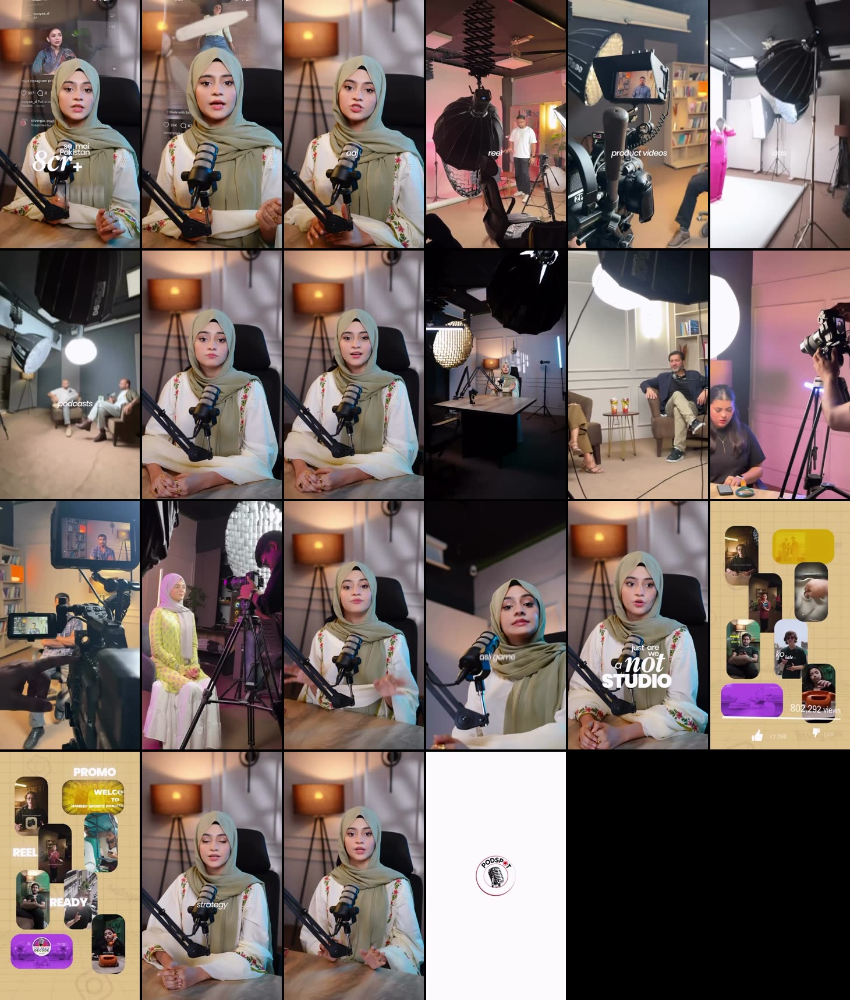

# Style: italic-kinetic

Learned from an Instagram reel (studio promo, Roman Urdu speech) shared by the owner on
2026-11-15. The owner asked to remember **the caption styling** for future videos.



## Captions (the main thing to keep)
- **1–2 words at a time**, following the speech closely (`words_per_line: 2`, `max_gap: 0.4`).
- **Lowercase, white, italic, rounded geometric sans** → `Poppins SemiBold` italic.
- **Medium size** (about 4.8% of the frame height), **in the middle of the frame, slightly
  low (y ≈ 0.62)**, over the speaker's chest/mic rather than at the bottom.
- **No box, no outline**, only a soft dark shadow. Quick fade in/out, no word highlight.
- Roman Urdu with English words as they are spoken ("product videos", "ads", "podcast").

## Emphasis titles (key numbers or punchlines)
Stacked mixed typography, centred on the speaker, instead of the normal caption:
- small italic lowercase words (`preset: small`, Poppins Medium italic), e.g. "se zyada / pakistan mein"
- one big elegant **serif italic** word (`preset: serif`, Playfair Display ExtraBold italic), e.g. "8cr", "not"
- a **heavy bold capitals** word (`preset: heavy`, Poppins Black), e.g. "STUDIO", "+"

Use them 2–4 times per minute, on the hook and on punchlines. Example:
```json
{"segments": [{"text": "just are we", "preset": "small"},
              {"text": "a", "preset": "small", "newline": true}, {"text": "not", "preset": "serif"},
              {"text": "STUDIO", "preset": "heavy", "newline": true}],
 "start": 36.9, "end": 38.6}
```
Don't show normal captions while an emphasis title is on screen (drop those caption lines).

## Pacing and the rest
- Fast: 22 shots in 53 s, average shot 2.4 s (0.6–5 s): talking head cut with B-roll of
  what is being talked about.
- Gentle push-in on shots (`zoom_in` 5%), hard cuts, no flashy transitions.
- Warm, natural look; light background music under the voice.
- Ends on a clean logo card.
