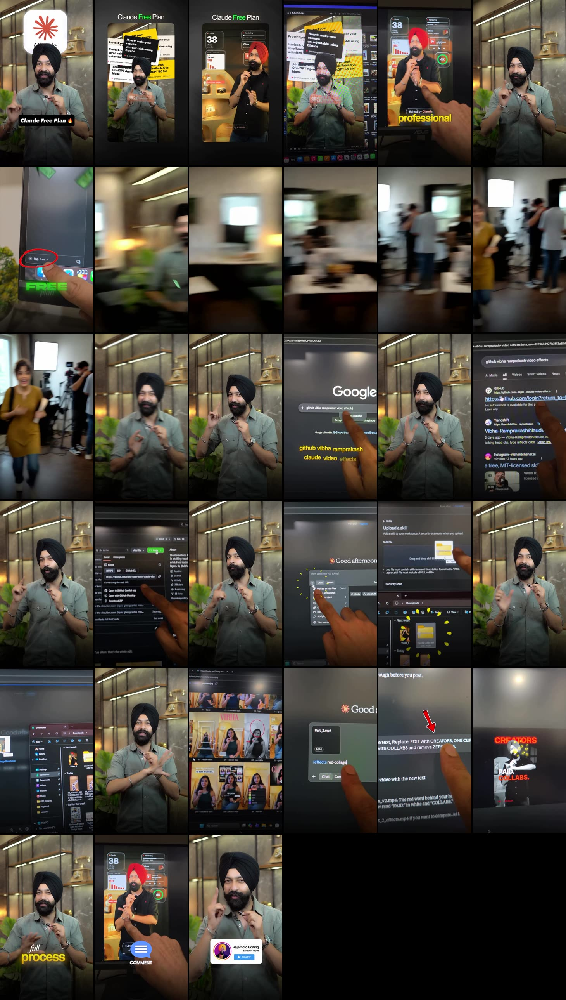
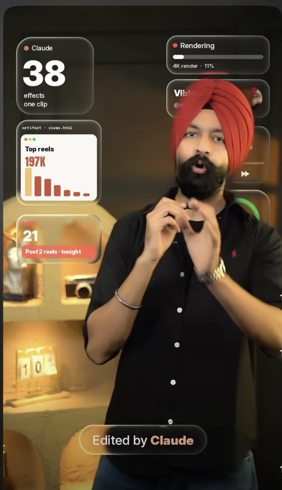

# Style: liquid-glass (effects library, NOT the default)

Learned from an Instagram reel (creator explaining video effects, Hindi) shared by the owner
on 2026-11-15. The owner said: use these effects **only when asked** ("liquid glass effect
add karo"). By default videos stay clean: just clean attractive captions and good SFX.



## Liquid glass (the effect the owner named)
Frosted, translucent rounded cards floating over the video, like iOS "liquid glass" widgets:
- the video behind the card is blurred and slightly brightened/saturated
- light white tint, brighter at the top (highlight), thin semi-transparent white border,
  rounded corners, soft shadow
- small clean text inside (numbers, labels: "38 effects", "Rendering", "Edited by Claude")
- also as a small pill at the bottom ("Edited by Claude")

How to do it here: `"glass"` items in edit.json (see tools/EDIT_FORMAT.md), e.g.
```json
"glass": [{"x": 0.5, "y": 0.2, "w": 0.72, "h": 0.09, "text": "Heavy Gold 5 in 1",
           "subtext": "dairy & qurbani animals", "start": 1.0, "end": 3.5}]
```
Use 1–3 small cards at a time, near the edges, never over faces; fade in/out.

## Other effects seen in this reference (on request)
- Keyword captions: one big bold word in yellow with a dark glow ("professional"), or a
  bold word + script word ("motion graphics", "full process") → use `segments` with Anton /
  Poppins Black in gold plus Playfair italic.
- Phone/card frame: the video shrunk into a rounded card on a dark background with a title
  above ("Claude Free Plan") — not built yet.
- Fast whip-pan blur transitions between scenes → `transition: "hblur"` or `"smoothleft"`.
- Glowing green outline around an object, red circle drawn around a button, comment / follow
  button pop-ups at the end → stickers via `overlays` (PNG) on request.
- Very fast pacing: 33 shots in 54 s (avg 1.6 s).

## Owner's box standard (2026-11-17)

Every info box is a liquid-glass widget like this photo: smoky dark glass over the blurred
video, thin light border, big radius; coloured dot + small label, big bold number/word, small
caption. Use `glass` with `label`, `value`, `sub`, `dot` (tools/EDIT_FORMAT.md).
