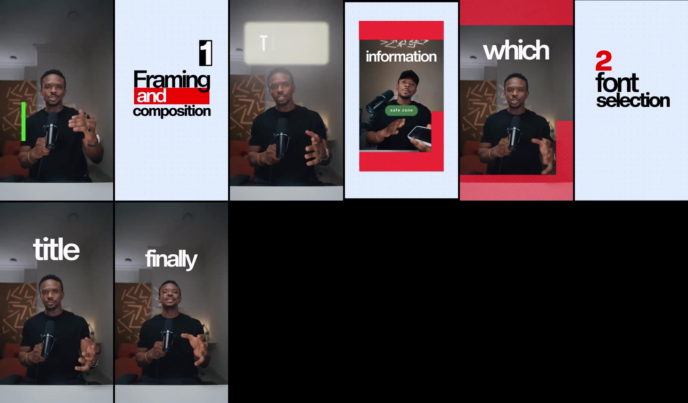

# Style: swiss-editorial (caption + graphics language, on request or to vary videos)

Learned from an Instagram reel (talking-head editing tutorial) shared by the owner on
2026-11-16: "absorb the writing at the top".

- **Top captions:** one or two words at a time near the top (inside the safe zone), huge tight
  grotesk lowercase (Inter Tight Black, tracking -5%, leading 0.8), white; the key word
  bigger in yellow (#FFF200) stacked under it ("talking / HEAD"). Words rise in with a blur.
  → `captions.style`: `{"mode": "html", "template": "swiss", "accent": "#FFF200"}`,
  `words_per_line` 1–2, mark the key word `*big*`.
- **Small body captions** (optional second layer): small white single words at chest height.
- **Section cards:** solid colour full screen (red #E10600) with "part" + big number in a
  black box, or light (#EAF1FF) with black type and one word on a red bar
  ("Framing / *and* / composition"). → card `"type": "section"`.
- **Tag boxes:** translucent rounded colour boxes (green #5AD32F, yellow #D4D400, red #E3262E)
  whose wide-tracked caps type in letter by letter ("TITLE", "FACE", "CAPTIONS").
  → card `"type": "tag"`.
- Thin accent bars as indicators; clean cuts; lots of empty space.
